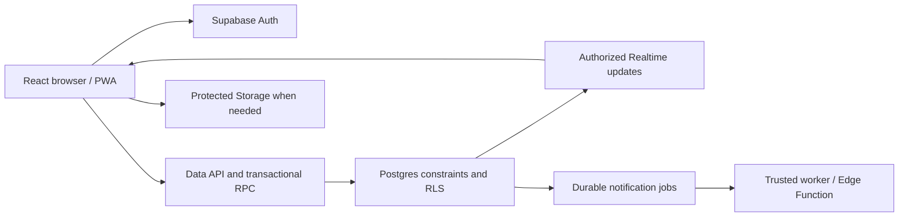

# Architecture plan

Status: required stack and current canonical client architecture direction established; broader backend implementation designs remain proposals where identified. Personal versus community scope was clarified on 2026-10-03; event/table boundaries and access rules were clarified on 2026-10-12 and remain unimplemented.

The 2026-10-15 profile plan adds global user profiles alongside curated community profiles and atomic join/profile submission (D-111/D-112). D-113–D-115 settle independent community visibility/global search/global matchmaking controls and account-level blocking with private labels. Remaining audience/lifecycle/UX details are Q-016. These changes are not implemented.

## Baseline

Use Vite, TypeScript, React Compiler, Supabase with multi-tenancy/RLS, and one mobile-first responsive web/PWA application. These explicit user choices override the handoff's tentative stack suggestions.

The Vite app lives directly at the repository root, with `src/`, `public/`, `package.json`, and `vite.config.ts` alongside `docs/`. React Compiler is configured. Run app scripts from the repository root. An [interactive frontend prototype](10-frontend-prototype.md) implements the five main sections with mock data and in-memory actions. Real Supabase Auth, identity/tenant migrations, atomic community creation, and an owner-only saved-community list now coexist with that prototype. Most domain persistence and PWA installation/offline behavior remain future work.

## Client architecture direction

The current canonical direction is pragmatic feature-oriented / vertical-slice organization: `app` composes startup, providers, routing, layout, and cross-feature pages; features own domain behavior and their route pages; generic primitives and proven shared product visuals have distinct homes; `lib` provides technical infrastructure. Feature UI reaches Supabase through feature data access and appropriate hooks/providers.

Plan for TanStack Query as the server-state layer and local React state for ordinary UI state. Use colocated CSS Modules and semantic CSS custom properties for controlled community theme presets. These are accepted directions for the upcoming refactor, not a claim that the prototype already follows them. Grow directories and abstractions only as actual code warrants; revisit choices when requirements change.

The [frontend patterns](05-frontend-patterns.md) own these boundaries and conventions, the [file structure plan](07-file-structure.md) distinguishes illustrative paths from current implementation/refactor candidates, and the [decision register](08-decisions-and-open-questions.md#client-architecture-review-questions) records open review points. The 2026-10-03 product clarification establishes My Home as the personal landing/feed and My Communities as the user's community hub, initially stubbed. Community Home, Meet & Play, Championship, Discussion, and Profile are scoped to the browsed community. Its owner is independent of the platform/domain owner. Community creation/management and social discussion have distinct feature ownership; see the vision and decision register. Production route/tenant URL design remains open.

## System responsibilities

Simple permitted reads and narrow updates use caller-scoped data access. Atomic seat, result, and administrative operations use database commands. Edge Functions handle external services, future payment integrations, or delivery workers where required. Several independent database calls from an Edge Function do not form one transaction.

Supabase Realtime is the proposed transport for event/table chat and community DM updates, with durable database messages as the source of truth. Storage supports profile photos if introduced; its access rules must match the profile audience. No general-purpose server or external chat network is needed by default.

Keep event/table chat roots tied to concrete parent FKs. For DMs, use general `direct_conversations`, authoritative `direct_conversation_participants`, `direct_conversation_messages`, and private `direct_conversation_user_states`. Initial one-to-one behavior is enforced by the UI and server API. Group DMs are a known later requirement: membership history and group operations can be added without replacing existing conversation/message identities. Omit conversation kind, stored pair fields, pair uniqueness, and database participant-count constraints/triggers. The creation API accepts one recipient; authorized commands own conversation/membership writes so clients cannot bypass the feature boundary. One continuing DM thread per identity pair within each community is accepted. Serialize every lookup/creation path within the command rather than encoding pair identity on the root; reusing an existing history must honor its read predicate independently of send eligibility. Group identity/reuse semantics remain later work. Keep private per-conversation mute/read state and coalesced in-app notification state separate from membership and receiving consent. Shared send validation enforces the 5,000-character limit and main-account budgets (30 messages/minute across chat types/communities and 10 new DM recipients/hour). DM reports use permanently retained selected-evidence/gap-metadata records. Submitters can read their own reports; active same-tenant staff with `can_handle_reports` can view, acknowledge, and resolve reports with required notes. Reviewers cannot traverse evidence into unreported bodies or use report handling as shared chat-hiding authority. Personal hides use per-message/viewer records; community-public event/table shared moderation uses separate per-message state and a permission-checked View Message read. DMs and private event/table chats have no shared staff moderation or inspection override; private-chat read-only oversight remains. Preserve canonical bodies and enforce shared hiding in backend projections/delivery. Main-account block identity is separate from each conversation's tenant boundary. Shared rendering/transport helpers may reuse code without collapsing authorization scopes. No polymorphic catch-all message table or full group feature is required now.

Model community account activity separately from standing; ordinary participation requires an active tenant and active approved account, while historical reads use their own predicates. Deactivation/archival orchestrate trusted cancellation, personal withdrawal, guest preservation, staff pausing, and durable notices across features. The owner participation exception preserves active management; active non-owner staff require active same-tenant community accounts throughout the assignment's active lifetime. Paused admin grants become effective only after target community reactivation and authorized manual can_grant_staff resumption. Removed-account reinstatement requires can_approve_users and does not resume staff. Enforce the cross-table activity invariant on both writes and authorization checks while retaining global identity FKs. Archived-community history retains each concrete resource audience. Keep `pause_community_events` as a settings-controlled public-creation gate, distinct from tenant archival; `can_manage_settings` edits settings flags without granting other management powers. These are planned additive changes to the implemented identity/tenant foundation. D-106–D-109 add scoped account removal and independent staff revocation: active/paused staff become revoked on removal; reappointment initially requires owner review of fresh grants. Removal withdraws upcoming personal bookings, optionally cancels explicitly selected guests, and cancels only unofficial not-yet-started hosted gatherings. Official gatherings remain collectively managed and are excluded from that cancellation flow. Keep in-progress handling explicit and history intact. Plan the value-preserving can_create_admin → can_grant_staff migration with the new can_remove_users/can_revoke_staff flags; trusted non-owner reappointment is a later refinement.

## Tenant and identity design

Use **one independently operated community per tenant**, initially The Crowded Table in Tegucigalpa (D-031). A home, café, or rented space is a location within a community, not a tenant. Accounts can associate with multiple communities. My Communities now has a stub; complete association listing and community switching will follow rather than being inferred from the existing owner-only list.

The precise future tenant business model still needs agreement. Do not create a commercial venue-management system or per-table tenants. Domain examples use `tenant_id`; a selected slug/ID is never authority.

Keep four independent concepts:

1. Account identity: who is signed in.
2. Community association and standing: tenant participation, approval, suspension/removal.
3. Future paid membership entitlement: deferred until a late stage; no current runtime access checks.
4. Resource participation: a particular confirmed seat, chat, or championship entry.

Personal presentation is separate from all four: `user_account_profiles` belongs to the global user-account capability; `community_account_profiles` belongs to the community relationship. Both initially store name/bio. Joining pre-fills an editable community draft from the global profile and atomically persists the submitted community account/profile; it does not create a live fallback or synchronization relationship. Global profile self-management has no community prerequisite. `community_accounts.show_global_profile` (default false) controls community-based global-profile visibility. Separate `user_accounts.user_is_discoverable` (default true) controls global account search, and `user_accounts.enable_matchmaking` (default true) controls global matchmaking. None depends on the other or grants standing, staff authority, or contact permission.

Keep safety enforcement and private-label targets on internal `user_accounts.user_id`: cross-community personal DM blocks, local staff discipline, and viewer-owned labels survive changes to either profile. Use account-level blocking and private labels instead of a public recognition code. Labels do not require a block, confer target-profile access, or expose hidden affiliations. D-116 makes global search/matching and direct-invitation restrictions bilateral for the blocked pair. D-118 extends private host/participant admission checks to both events and tables and automatically removes existing counterpart participation/requests and rejects related invitations in both host directions on block confirmation, limited by D-119 to not-yet-started resources. Ordinary community joining and unaffected shared participation remain permitted; a personal block is not a universal shared-resource authorization predicate. D-117/D-118 compose an authorized preview separating mandatory private effects from optional per-item actions for not-yet-started non-private resources only. Reuse owning-domain transitions, including linked-seat effects, through the narrow block policy for mandatory changes and ordinary caller permissions for manual choices. Confirm these effects consistently with the block; dismissal is inert and unblocking restores no cancelled items. Evaluate blocks against the actual attendee, never their guest booker as a proxy. Preserve independent guest participation and group links. Block-triggered changes and cascades must leave in-progress events/tables and their existing access unaffected, with a start-time recheck at confirmation. Independent matchmaking/hosting retain their own resource design, and existing-match/other residual lifecycle effects remain Q-010.

Current participation uses community standing, privacy, and resource registration. Payments and paid memberships are absent from current functionality; their later implementation must remain separate from staff authority.

## Domain boundaries

| Domain | Responsibility |
| --- | --- |
| User accounts | Global application account/profile, global search and matchmaking preferences, and private labels; self-management and explicitly authorized projections. Auth continues to own credentials/session behavior; matchmaking owns its matching workflow |
| Events | Gatherings with zero or more tables; sponsorship, public/private audience, invitations, registration, admission, and attendance |
| Tables / Meet & Play | Individual game sessions, account-holder and guest seats, requests, confirmation, waiting, and matching requests |
| Membership / payments (deferred) | No current feature or authorization dependency; design commercial behavior near the end of implementation |
| Participation | One event registration per attendee and table participation per person; separate booking account, atomic group acceptance, eligibility, capacity, states, and attendance |
| Event/table chat | Concrete event/table message and lifecycle tables; active resource-specific access, private staff oversight, read-only cancellation, and indefinite authorized archived history |
| Direct messaging | MVP within one tenant with approved community accounts at both endpoints; general conversations/participants/messages/private state with initial one-to-one UI/API behavior, initial report/block controls, restricted report evidence, and separate history/send authorization |
| Championship | Registrations, versioned rules, match evidence/confirmation, standings, finals |
| Communities | User-owned community creation/management, associations, curated community profiles, atomic joining, community identity, and community-account `show_global_profile` |
| Discussion | Community-scoped discussions, directory, moderation |
| Admin | Authorized commands with audit records |
| Notifications | Durable in-app notices and retryable delivery; external channels undecided |

Events and tables have separate roots; the former shared activity/subtype proposal is superseded. A table may stand alone or belong to an event. Under D-110, attached tables derive official/unofficial classification from their event with no independent override; only standalone tables store their own classification. Authorization and moderation use that same effective value. Sponsorship remains separate from host identity and public/private audience. Event registration approval precedes associated table seating, and explicitly cancelling an attendee's registration clears that attendee's associated reservations. Cancelling the event/table itself preserves every registration/participation row. Only organizers may add unofficial tables to an event; official event/table creation and management require `can_manage_official_events`. Event attendance capacity and table seat capacity remain separate; guest seats count toward capacity, and new guest bookings require `tables.allow_guests` (default true). Disabling guests preserves existing bookings and prompts the table manager with optional guest-removal controls; removal is an explicit table-management action available at any time. See the [schema direction](03-database-schema.md#events-tables-locations-and-seats) for confirmed rules and remaining physical-design choices. Shared presentation or transaction helpers must preserve each domain's authorization and lifecycle.

Use one event registration per actual attendee and one table participation per person. Track the booking account separately, so guest-only bookings create no sponsor attendance/seat. An event-table participation references its occupant's exact event registration; standalone participation carries attendee/guest information directly. Groups must be accepted together in one database transaction, validating every member and full capacity before any approval/confirmation. Durable group membership supports this operation while retaining per-person identity and cancellation. The UI may submit a party in one action; feature data access must use a transactional group command rather than loop over per-person acceptance calls.

The initial table setting is `manually_confirm_seats = false`: eligible non-withdrawn whole groups confirm automatically in receipt order when they fit. True enables manager approval/rejection/issue notices; approval directly confirms without booker acceptance or expiry. Rejections leave the active queue and promptly notify the booking account with timestamp, actor, and optional reason. Guest-name edits/removals preserve pending-group priority; additions reset it after explanation. Offered seats, claim windows, and payment holds are deferred.

Switching an existing manual table to automatic mode requires a modal explaining that queued requests will be processed automatically in receipt order as eligible whole groups fit. Continue triggers the switch and queue processing; Cancel closes the modal and leaves manual mode true. Preserve the existing queue priority rules during the switch.

Events/tables use identical retained cancelled/archived lifecycle rules, with no hard deletion or initial reopening. Direct archival requires zero booking rows of any status at cancellation or 30 continuous cancelled days. Parent cancellation sets attached table statuses to cancelled except already-archived tables; parent archival sets all attached table statuses to archived. Perform the dependent transitions together, preserving every per-person booking row and prior cancellation history. Cancelled community-public resources are visible to anonymous visitors through safe public details and a Cancelled filter; private resources preserve their audience. Historical registrants/participants and guest bookers retain scoped cancelled/archived visibility and read-only chat indefinitely, alongside former unofficial organizers and authorized staff. Cancellation revokes chat sends and participant-based addresses. See the [canonical lifecycle/access rules](03-database-schema.md#event-cancellation-and-archival--accepted-rules).

## Data exposure

- Public: summaries of events published to the community, including permitted user-posted events, safe display locations and championship overview. Public leaderboard identity details remain open.
- Community participation: approved, non-banned account holders, plus sponsored guests where allowed. Guest names are optional; sponsors may book guests without registering themselves, attending, or playing. Public visibility does not confer participation or reveal private invitations/tables. Admission conditions remain separate; payment and membership gates are deferred.
- Community-restricted: directory and Discussion content under audience policies; no paid-membership gate.
- Resource-restricted: private addresses and event/table chats follow their own participant/organizer/staff/lifecycle rules. Community DMs require same-tenant community accounts at both endpoints and conversation-specific access; private-event oversight does not grant DM reads.
- Self-only: private account preferences and pending requests; commercial history is deferred.
- Management and historical access: scoped management decisions, disputes, reports, and audit data remain restricted. `can_manage_community_events` permits cancellation/archival of unofficial community-public events/tables and community-public unofficial chat moderation; official management and community-public official-chat moderation require `can_manage_official_events`. Private chats are excluded from staff shared hiding and moderator inspection regardless of other grants. `can_see_private_events` retains private oversight reads, not writes, shared chat hiding, moderator inspection, or addresses. Historical archive/chat reads also belong to qualifying non-staff users and guest bookers; read, send, address, and management permissions are distinct.

Store exact addresses separately from safe location summaries. Never include private addresses in list/detail payloads, public views, notifications, logs, or Realtime broadcasts. Access to an address needs a dedicated authorized read.

## Money versus access

Payments and paid memberships are among the last features to implement. Current flows act as though they do not exist: no pricing/checkout, payment simulation or manual verification, entitlements, or member-only gates. Community association/approval and resource authorization remain necessary. Retain old commercial concepts only as deferred proposals; they must not block event/table/refactor work or become hidden backend eligibility dependencies.

## Operations and tooling

Use separate local, non-production, and production data/configuration. Version migrations, grants, policies, functions, and generated types. Keep Supabase secret/service credentials in trusted runtimes; only public configuration goes to the browser. [Vite environment guidance](https://vite.dev/guide/env-and-mode) explains client-exposed environment variables.

Router, form/validation libraries, any primitive-component library, PWA tooling, and hosting remain unselected. TanStack Query is the planned server-state choice; CSS Modules and token-based preset theming are the client styling direction. Resend is selected for initial Auth email; broader notification delivery channels remain open. Keep the app at the repository root. There is no current seat-expiry worker. Add scheduled work for chat archival only with an explicit reliable execution mechanism and retry/monitoring plan.
