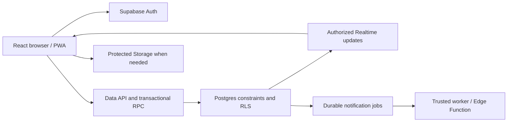

# Architecture plan

Status: required stack and current canonical client architecture direction established; broader backend implementation designs remain proposals where identified. Personal versus community scope was clarified on 2026-10-03; event/table boundaries and access rules were clarified on 2026-10-12 and remain unimplemented.

## Baseline

Use Vite, TypeScript, React Compiler, Supabase with multi-tenancy/RLS, and one mobile-first responsive web/PWA application. These explicit user choices override the handoff's tentative stack suggestions.

The Vite app lives directly at the repository root, with `src/`, `public/`, `package.json`, and `vite.config.ts` alongside `docs/`. React Compiler is configured. Run app scripts from the repository root. An [interactive frontend prototype](10-frontend-prototype.md) implements the five main sections with mock data and in-memory actions. Real Supabase Auth, identity/tenant migrations, atomic community creation, and an owner-only saved-community list now coexist with that prototype. Most domain persistence and PWA installation/offline behavior remain future work.

## Client architecture direction

The current canonical direction is pragmatic feature-oriented / vertical-slice organization: `app` composes startup, providers, routing, layout, and cross-feature pages; features own domain behavior and their route pages; generic primitives and proven shared product visuals have distinct homes; `lib` provides technical infrastructure. Feature UI reaches Supabase through feature data access and appropriate hooks/providers.

Plan for TanStack Query as the server-state layer and local React state for ordinary UI state. Use colocated CSS Modules and semantic CSS custom properties for controlled community theme presets. These are accepted directions for the upcoming refactor, not a claim that the prototype already follows them. Grow directories and abstractions only as actual code warrants; revisit choices when requirements change.

The [frontend patterns](05-frontend-patterns.md) own these boundaries and conventions, the [file structure plan](07-file-structure.md) distinguishes illustrative paths from current implementation/refactor candidates, and the [decision register](08-decisions-and-open-questions.md#client-architecture-review-questions) records open review points. The 2026-10-03 product clarification establishes My Home as the personal landing/feed and My Communities as the user's community hub, initially stubbed. Community Home, Meet & Play, Championship, Discussion, and Profile are scoped to the browsed community. Its owner is independent of the platform/domain owner. Community creation/management and social discussion have distinct feature ownership; see the vision and decision register. Production route/tenant URL design remains open.

## System responsibilities

Simple permitted reads and narrow updates use caller-scoped data access. Atomic seat, result, and administrative operations use database commands. Edge Functions handle external services, future payment integrations, or delivery workers where required. Several independent database calls from an Edge Function do not form one transaction.

Supabase Realtime is the proposed transport for table chat updates, with durable database messages as the source of truth. Storage supports profile photos if introduced; its access rules must match the profile audience. No general-purpose server or external chat network is needed by default.

## Tenant and identity design

Use **one independently operated community per tenant**, initially The Crowded Table in Tegucigalpa (D-031). A home, café, or rented space is a location within a community, not a tenant. Accounts can associate with multiple communities. My Communities now has a stub; complete association listing and community switching will follow rather than being inferred from the existing owner-only list.

The precise future tenant business model still needs agreement. Do not create a commercial venue-management system or per-table tenants. Domain examples use `tenant_id`; a selected slug/ID is never authority.

Keep four independent concepts:

1. Account identity: who is signed in.
2. Community association and standing: tenant participation, approval, suspension/removal.
3. Future paid membership entitlement: deferred until a late stage; no current runtime access checks.
4. Resource participation: a particular confirmed seat, chat, or championship entry.

Current participation uses community standing, privacy, and resource registration. Payments and paid memberships are absent from current functionality; their later implementation must remain separate from staff authority.

## Domain boundaries

| Domain | Responsibility |
| --- | --- |
| Events | Gatherings with zero or more tables; sponsorship, public/private audience, invitations, registration, admission, and attendance |
| Tables / Meet & Play | Individual game sessions, account-holder and guest seats, requests, confirmation, waiting, and matching requests |
| Membership / payments (deferred) | No current feature or authorization dependency; design commercial behavior near the end of implementation |
| Participation | One event registration per attendee and table participation per person; separate booking account, atomic group acceptance, eligibility, capacity, states, and attendance |
| Chat | Confirmed table participants, durable messages, archival |
| Championship | Registrations, versioned rules, match evidence/confirmation, standings, finals |
| Communities | User-owned community creation/management, associations, and community identity |
| Discussion | Community-scoped discussions, directory, moderation |
| Admin | Authorized commands with audit records |
| Notifications | Durable in-app notices and retryable delivery; external channels undecided |

Events and tables have separate roots; the former shared activity/subtype proposal is superseded. A table may stand alone or belong to an event. Event registration approval precedes associated table seating, and explicitly cancelling an attendee's registration clears that attendee's associated reservations. Cancelling the event/table itself preserves every registration/participation row. Only organizers may add tables to an event. Event attendance capacity and table seat capacity remain separate; guest seats count toward capacity, and new guest bookings require `tables.allow_guests` (default true). Disabling guests preserves existing bookings and prompts the table manager with optional guest-removal controls; removal is an explicit table-management action available at any time. See the [schema direction](03-database-schema.md#events-tables-locations-and-seats) for confirmed rules and remaining physical-design choices. Shared presentation or transaction helpers must preserve each domain's authorization and lifecycle.

Use one event registration per actual attendee and one table participation per person. Track the booking account separately, so guest-only bookings create no sponsor attendance/seat. An event-table participation references its occupant's exact event registration; standalone participation carries attendee/guest information directly. Groups must be accepted together in one database transaction, validating every member and full capacity before any approval/confirmation. Durable group membership supports this operation while retaining per-person identity and cancellation. The UI may submit a party in one action; feature data access must use a transactional group command rather than loop over per-person acceptance calls.

The initial table setting is `manually_confirm_seats = false`: eligible non-withdrawn whole groups confirm automatically in receipt order when they fit. True enables manager approval/rejection/issue notices; approval directly confirms without booker acceptance or expiry. Rejections leave the active queue and promptly notify the booking account with timestamp, actor, and optional reason. Guest-name edits/removals preserve pending-group priority; additions reset it after explanation. Offered seats, claim windows, and payment holds are deferred.

Switching an existing manual table to automatic mode requires a modal explaining that queued requests will be processed automatically in receipt order as eligible whole groups fit. Continue triggers the switch and queue processing; Cancel closes the modal and leaves manual mode true. Preserve the existing queue priority rules during the switch.

Events have retained cancelled/archived lifecycle states, with no hard deletion. Archive eligibility is no registrations at cancellation or 30 continuous cancelled days. Cancelled events remain discoverable through a community-user filter; archived events are staff-only. Cancellation notifies queued/confirmed event registrants with timestamp, actor, and optional reason. Recommended child behavior derives availability from the table and parent event without rewriting historical booking rows. See the [cancellation policy and remaining choices](03-database-schema.md#event-cancellation-and-archival--accepted-rules).

## Data exposure

- Public: summaries of events published to the community, including permitted user-posted events, safe display locations and championship overview. Public leaderboard identity details remain open.
- Community participation: approved, non-banned account holders, plus sponsored guests where allowed. Guest names are optional; sponsors may book guests without registering themselves, attending, or playing. Public visibility does not confer participation or reveal private invitations/tables. Admission conditions remain separate; payment and membership gates are deferred.
- Community-restricted: directory and Discussion content under audience policies; no paid-membership gate.
- Resource-restricted: private addresses and table chat, subject to their respective participant, host, staff, and lifecycle rules.
- Self-only: private account preferences and pending requests; commercial history is deferred.
- Staff-restricted: scoped management decisions, disputes, moderation reports, and audit data. `can_see_private_events` allows same-community private event/invitation/table visibility and table chat reads without write authority; it excludes private addresses. `can_manage_events` permits cancellation in place of deletion, but no other changes, to publicly posted user events. Archived events are staff-only; archive write authority and the private-audience intersection remain to finalize.

Store exact addresses separately from safe location summaries. Never include private addresses in list/detail payloads, public views, notifications, logs, or Realtime broadcasts. Access to an address needs a dedicated authorized read.

## Money versus access

Payments and paid memberships are among the last features to implement. Current flows act as though they do not exist: no pricing/checkout, payment simulation or manual verification, entitlements, or member-only gates. Community association/approval and resource authorization remain necessary. Retain old commercial concepts only as deferred proposals; they must not block event/table/refactor work or become hidden backend eligibility dependencies.

## Operations and tooling

Use separate local, non-production, and production data/configuration. Version migrations, grants, policies, functions, and generated types. Keep Supabase secret/service credentials in trusted runtimes; only public configuration goes to the browser. [Vite environment guidance](https://vite.dev/guide/env-and-mode) explains client-exposed environment variables.

Router, form/validation libraries, any primitive-component library, PWA tooling, and hosting remain unselected. TanStack Query is the planned server-state choice; CSS Modules and token-based preset theming are the client styling direction. Resend is selected for initial Auth email; broader notification delivery channels remain open. Keep the app at the repository root. There is no current seat-expiry worker. Add scheduled work for chat archival only with an explicit reliable execution mechanism and retry/monitoring plan.
