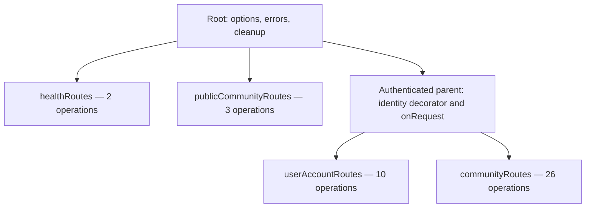
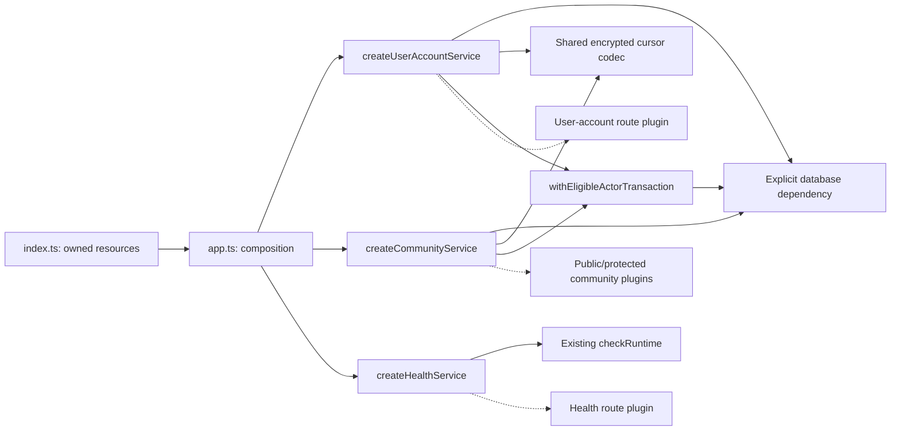

# Final Fastify architecture refactoring plan

**Issue #15 complete local policy migration — 2026-11-10.** All current local gates pass through migration `20261110000800`: real Auth/HTTP and concurrency/retry/semantic-audit suites, the unchanged HTTP baseline, full client/database/type/lint/build checks, clean replay and populated forward upgrade preserving all application data/history. All 31 original function dispositions reconcile to 18 final functions; the exact restricted runtime manifest and G-02 remain intact with zero external application grants. See [policy migration verification summary](12-implementation-status.md#policy-migration-verification-summary) for commands, trust boundaries and independent full-integration review. Current communities/user accounts use routes, JSON schemas, types, policies and services; health retains its schema-free HTTP boundary and existing triad. Use the explicit local target for local fixture suites. The separately authorized hosted migration and verification are complete; parent #5 and #15 are closed. See [hosted completion summary](12-implementation-status.md#policy-migration-verification-summary). Deferred features and frontend/API hosting remain separate. Earlier unstarted/four-file/hosted-ready statements below record prior milestones, not current-source readiness.

**Issue #14 global profile/block checkpoint - 2026-11-10.** Authorized local implementation moves global discovery/exact-profile audiences and profile-sourced block authorization into user-account policies, composing community-owned sharing/source predicates. Local migration 20261110000800 retires all four replaced functions and dependent business RLS; runtime fact reads, self mutations, trusted attribution, G-02 and external denial remain distinct. See [checkpoint summary](12-implementation-status.md#policy-migration-verification-summary) for verification and review. Issue #13 is closed; issue #15 and hosted deployment retain separate scope. Earlier pending statements describe prior stages.

**Issue #13 public community query checkpoint - 2026-11-10.** Authorized local implementation moves exact-slug landing and public-directory queries/audiences into the community API. Local migration 20261110000700 retires both projection functions; narrow anonymous runtime read/root-lock scope retains G-02, write denial and external Data API denial. See [checkpoint summary](12-implementation-status.md#policy-migration-verification-summary) for the boundary, verification and review. Issues #14-#15 and hosted deployment retain separate scope. Earlier pending statements describe prior stages.

**Issue #12 profile/self-service checkpoint - 2026-11-10.** Authorized local implementation moves own profiles/preferences, exact community profiles, member directories and personal summary audiences into feature policies. The retained caller-only archived-card projection has a community-owned adapter. Local migration 20261110000600 retires all remaining normalization triggers and community self-edit business policies; canonical future writes, historical biography bytes, self scope, G-02 and inactive-sharing safeguards remain protected. See [checkpoint summary](12-implementation-status.md#policy-migration-verification-summary) for the exact boundary, verification and review. Issue #11 is closed; #13-#15 and hosted deployment retain separate scope. Earlier pending statements describe prior stages.

**Issue #11 semantic-audit checkpoint - 2026-11-10.** Authorized local implementation moves all covered semantic event/category writers and history audience predicates into the community API. Local migration 20261110000500 retires automatic audit/classification and history business RLS; PostgreSQL retains scoped storage, structural/reference validation, trusted provenance and append-only protection, without semantic completeness claims. See [checkpoint summary](12-implementation-status.md#policy-migration-verification-summary) for the writer inventory, exact runtime boundary, verification and review. Issues #12-#15 and hosted deployment retain separate scope. Earlier pending statements describe prior stages.

**Issue #10 account-record checkpoint - 2026-11-10.** Authorized local implementation moves owner/exact account facts, staff/participant record audiences and participant-management authority into community policies. Local migration 20261110000400 retires the management function and participant business policies; scoped storage, G-02, attribution and existing audit classification remain. Permission responses reuse locked/updated rows. See [checkpoint summary](12-implementation-status.md#policy-migration-verification-summary) for verification and review. Issue #9 is closed; #11-#15 and hosted deployment retain separate scope. Earlier pending/unstarted statements describe prior stages.

**Issue #9 configuration/archive checkpoint - 2026-11-10.** Authorized local implementation moves configuration reads/detail/settings/copy writes and archive/restore decisions into community policies. Local migration 20261110000300 retires the configuration permission functions, dependent business policies and tenant normalization trigger; scope, canonical storage, G-02, profile normalization and automatic audit loggers remain. See [checkpoint summary](12-implementation-status.md#policy-migration-verification-summary) for the exact runtime boundary, verification and review. Issues #10-#15 and hosted deployment retain separate scope. Earlier pending/unstarted statements describe prior stages.

**Issue #8 community action-policy checkpoint - 2026-11-10.** Authorized local implementation introduces community lifecycle/staff policies, a fact-only protected Auth primitive, explicit API sharing cleanup and rejection-only database integrity. Local migrations 20261110000100 and 20261110000200 replace the mixed candidate function and enable tenant-scoped lifecycle clearing; external grants and the archive fence remain. See [checkpoint summary](12-implementation-status.md#policy-migration-verification-summary) for the exact runtime boundary, verification and review. Issue #7 is complete and closed; #9-#15 and hosted deployment remain pending. Earlier unstarted/four-file statements describe prior stages.

**Issue #7 transaction-retry checkpoint - 2026-11-10.** Authorized implementation adds at most three complete transaction attempts for confirmed PostgreSQL 40001/40P01 errors, with fresh context/eligibility/authorization and one correlation identity. Anonymous community reads retain their identity contract. Business/stale errors and uncertain commits are not replayed. See [checkpoint summary](12-implementation-status.md#policy-migration-verification-summary) for commands, verification and review. Issue #6 is complete and closed; policy/workflow cutovers in #8-#15 and hosted work remain pending. Earlier unstarted statements describe the design/publication stage.

**Authorization ownership follow-up, 2026-11-10.** [ADR 0001](adr/0001-api-policy-ownership.md) accepts feature-local `policies.ts` ownership of action-specific facts queries, decisions, authorization requirements and SQL audience predicates. Services retain transaction/lock coordination, mutations and workflow effects. This revises the exactly-four-file target for affected features; the completed phases, checkpoints and implementation evidence remain intact. All design choices are settled; shared understanding is confirmed, and implementation is not authorized.

Policy modules use named function exports, separate database fact loading from pure evaluation/denial requirements, and own their policy fact/decision types. Operation input/result contracts remain in `types.ts`. The accepted database-type follow-up replaces Supabase generation with one `kysely-codegen` schema covering application-owned public/private tables, including verified generated-column restrictions.

The [policy implementation plan](23-api-policy-implementation-plan.md) defines the accepted local checkpoints and carries forward the relevant verification gates below. Narrow Auth-provisioning and archive-read exceptions are accepted. Hosted migration/verification is a separate subsequent step; the previous structural work remains complete.

**Status: completed and locally verified, 2026-11-04; all five phases complete.** The HTTP baseline, shared facilities/resource ownership and all three feature triads are implemented. The eight community groups retain their independent commits. Phase 5 completes health, transport typing and final cleanup/verification. See [Phase 1 verification summary](12-implementation-status.md#fastify-refactor-phase-1--2026-11-04), [Phase 2 verification summary](12-implementation-status.md#fastify-refactor-phase-2--2026-11-04), [Phase 3 verification summary](12-implementation-status.md#fastify-refactor-phase-3--2026-11-04), [Phase 4 verification summary](12-implementation-status.md#fastify-refactor-phase-4--2026-11-04) and [Phase 5 verification summary](12-implementation-status.md#fastify-refactor-phase-5--2026-11-04).

This plan governs the structural refactor of the existing persistent API. The [approved API transition](20-persistent-api-transition-proposal.md), [intended access matrix](16-intended-access-matrix.md), and [final access audit](21-final-local-access-audit.md) remain the behavior and security context. It supersedes earlier proposed target structures from the architecture-planning discussion, not accepted product or database requirements.

## 1. Scope and target structure

The completed five-phase refactor established frontend-aligned three-file features. The [accepted four-file follow-up](#7-four-file-feature-follow-up--2026-11-10) now governs communities and user accounts; health retains `routes.ts`, `service.ts`, and `json-schema.ts` (filename aligned on 2026-11-11). Preserve all 41 explicit HTTP operations, 28 automatic HEAD operations, and existing security/database behavior.

Health filename alignment — locally verified 2026-11-11: renamed `schema.ts` to `json-schema.ts` at the user's request for consistency with other features and updated its type-only route import. Reply definitions and the absence of runtime health schemas are unchanged. Server TypeScript, root lint, and all 26 health/HTTP-baseline tests passed. No deployment is included or remaining work required for this rename.

Phase 1 changed tests/documentation, Phase 2 changed shared facilities/callers, Phase 3 moved user-account operations into their triad, Phase 4 migrated all eight community groups, and Phase 5 completed health, transport typing and final reconciliation. All preserve the HTTP contract. No shared browser contract, database migration, runtime privilege or frontend change is included.

```text
server/src/
├── index.ts
├── app.ts
├── token-verifier.ts
├── http-authentication.ts
├── http-errors.ts
├── database.ts
├── directory-cursors.ts
│
├── user-accounts/
│   ├── routes.ts
│   ├── service.ts
│   ├── json-schema.ts
│   └── types.ts
├── communities/
│   ├── routes.ts
│   ├── service.ts
│   ├── json-schema.ts
│   └── types.ts
└── health/
    ├── routes.ts
    ├── service.ts
    └── json-schema.ts
```

The authentication/error filenames resolve concrete responsibility overlap without adding runtime layers.

### Authentication and error ownership

| Module | Exact responsibility |
| --- | --- |
| `token-verifier.ts` | Construct the Supabase-backed bearer verifier and validate token identity claims. No Fastify imports, hooks, HTTP responses, or database eligibility checks. |
| `http-authentication.ts` | Required/optional HTTP authentication integration, request identity decoration, authenticated-context extraction, and existing authentication-related cache headers. Receives the verifier explicitly; does not construct it. |
| `database.ts` | Own connection construction, database types, runtime verification and actor-scoped transactions. Export `AuthenticatedContext`, `IneligibleActorError` and `withEligibleActorTransaction`; bind trusted attribution and perform the locked database eligibility check, throw the typed error on denial and return callback values directly. No Fastify or HTTP response dependencies. |
| `http-errors.ts` | Define `ApplicationError` with its existing status/code representation. Own the common error-response schema and existing root error-handler translation/logging, including database eligibility errors as 403 `ineligible`. Preserve PostgreSQL, application-error and unexpected-error mappings exactly. |

Authentication failures retain the current direct 401 response. They do not need to pass through a new exception mechanism.

Feature-specific result-to-HTTP mappings remain in `routes.ts`. Operation-specific failures remain explicit; the root error handler must not normalize distinct existing outcomes.

### Other root responsibilities

- `index.ts`: validate configuration, construct resources, start listening, handle signals and startup failures.
- `app.ts`: construct feature services, register plugins, install root options/errors and owned cleanup.
- `database.ts`: retain pool/Kysely construction, database types and runtime verification, and own the actor-scoped transaction helper and its context/result types.
- `directory-cursors.ts`: retain the shared encrypted cursor mechanism; feature services retain their endpoint-specific scopes and other existing cursor formats.

No additional architectural directories, repository layer, DI container, validation library, or `fastify-plugin` dependency are required.

## 2. Feature ownership and parallel organization

Each feature uses identical section names and ordering across routes, HTTP schemas and services. Communities/user accounts organize their standalone contracts consistently with those operations where applicable. Within a section, route declarations, public service operations and schema exports follow the same operation order.

Use concise section comments. Place supporting helpers immediately after their related operations; place genuinely feature-wide helpers in a final `Internal helpers` section. Shared schema fragments may precede the operation sections.

Sections are navigation aids, not additional plugins or directories.

### `user-accounts`: 10 operations

All routes register beneath the authenticated parent.

| Section, in order | Operations | Frontend correspondence |
| --- | --- | --- |
| **Account preferences** | GET/PUT `/api/me/preferences` | `user-accounts/api.ts`; Settings |
| **Own profile** | GET/PUT `/api/me/profile` | `user-accounts/api.ts`; shared profile state and editor |
| **My communities** | GET `/api/me/communities` | `user-accounts/api.ts`; personal community list |
| **Global profiles** | GET `/api/profiles`; GET `/api/profiles/:userId` | No current frontend adapter |
| **Account blocks** | GET `/api/me/blocks`; PUT/DELETE `/api/me/blocks/:userId` | No current frontend adapter |

Personal community summaries remain owned here because this feature owns the operation and its frontend adapter. Reading community relations does not require an additional community-service layer.

`AuthShell` initializes shared account state through the existing user-account hook. This shared consumption does not create a second HTTP owner.

### `communities`: 29 operations

Here, `C` means `/api/communities/:tenantId`.

| Section, in order | Operations | Count |
| --- | --- | ---: |
| **Public access and standing** | GET `/api/community-standings`; GET `/api/public/communities/:slug`; GET `/api/public/communities/:slug/directory` | 3 |
| **Creation and lifecycle** | POST `/api/communities`; POST `C/commands` | 2 |
| **Requests and reviews** | GET `C/me/request`; GET `C/accounts/:target/review`; GET `C/staff-candidates`; GET `C/requests` | 4 |
| **Profiles and preferences** | GET `C/accounts/:userId/profile`; PATCH `C/me/profile`; GET/PATCH `C/me/preferences` | 4 |
| **Configuration and copy** | GET/PATCH `C/details`; GET/PATCH `C/settings`; GET `C/copy`; PUT/DELETE `C/copy/:contentKey` | 7 |
| **Directories and account facts** | GET `C/directory`; GET `C/accounts`; GET `C/accounts/:userId` | 3 |
| **Staff and participant permissions** | GET `C/staff`; GET `C/staff/:userId`; GET `C/participant-permissions`; GET/PATCH `C/accounts/:userId/permissions` | 5 |
| **Audit history** | GET `C/history` | 1 |

The three public operations register outside the authenticated parent. The other 26 register beneath it.

Frontend consumers remain:

- Creation: `communities/api.ts` through `command-client.ts`, connected to the creation UI.
- Commands: `sendCommunityCommand` adapter exists without a current non-test UI caller.
- Own profile/preference writes: adapters exist in `communities/api.ts`; current sample screens use mock saves.
- Remaining operations: no current frontend adapter.

No new frontend callers or frontend restructuring are included.

### `health`: 2 operations

Parallel sections are **Liveness**, then **Readiness**:

- GET `/health/live`
- GET `/health/ready`

Health has no frontend counterpart because it serves operational probes. It still follows the three-file convention.

Other frontend features currently use Supabase Auth or mock functionality; do not create empty backend features for symmetry.

## 3. Plugin boundaries, dependencies and contracts

### Fastify hierarchy



`communities/routes.ts` exports both `publicCommunityRoutes` and `communityRoutes`. No additional public/reference directory or plugin nesting is needed.

Preserve these lifecycle distinctions:

- Protected routes inherit required authentication and `private, no-store`.
- Public landing/directory retain route-specific optional authentication in `onRequest` and `no-store`.
- Standing reference retains optional verification inside its handler, after validation, with its existing cache behavior.
- Health remains outside authentication.
- Preserve complete existing paths, automatic HEAD registration and root not-found behavior.

### Service construction



Factories return ordinary named functions:

- `createUserAccountService({ db, cursors })`
- `createCommunityService({ db, cursors })`
- `createHealthService({ checkReadiness })`

Plugin options contain only their required service operations. Public community registration additionally receives the bearer verifier. Protected feature plugins do not receive database handles or verifiers.

No direct dependency between the two feature services is needed for current operations. Preserve existing private PostgreSQL functions for cross-table authority and projections.

### Final abstraction names

- **`AuthenticatedContext`**: readonly `{ actorId: string; requestId: string }`. Represents verified identity and correlation, not current eligibility or authorization.
- **`withEligibleActorTransaction(db, context, work, options?)`** assigns actor and operation context, locks Auth eligibility, then establishes the optional initial tenant in one restricted invoker submission. Identity and correlation remain in `AuthenticatedContext`. The callback receives the transaction and returns its result directly. Denial rolls back with `IneligibleActorError`. Complete retries re-establish all context. Existing-tenant community helpers receive an already scoped transaction. Operations requiring a tenant-root lock retain a separate statement for subsequent authorization reads. See the [integrated checkpoint](12-implementation-status.md#integrated-tenant-setup-verification).
- **`IneligibleActorError`**: database-owned error without HTTP metadata. Replaces the historical eligibility result envelope; the root handler maps it to 403 `ineligible`, with account review retaining route-owned 403 `unavailable`.
- **`BuildApiOptions`**: required `{ db, verify, cursors, cleanup }` application construction inputs only—database, verifier, cursor codec and explicit asynchronous cleanup callback. Never passed wholesale to features. The old positional construction signature is removed.

Normal cleanup belongs to `app.close()` after `buildApi` successfully returns. Startup cleans up allocated resources when construction fails before ownership transfers; later boot/readiness/listener failures close the returned app. Startup supplies one memoized cleanup promise and shares one close request across shutdown signals. Preserve cleanup exactly once, await failed-startup cleanup, retain the original startup failure if cleanup also rejects, and remove installed signal handlers on close. Shutdown failures use a generic diagnostic and nonzero exit status. No new timeout or force-close policy is introduced.

### Feature dependency rules

**`routes.ts`**

- Owns endpoint paths, Fastify registration, lifecycle integration, schema attachment, validated input/context extraction and HTTP response mapping.
- Calls named service operations.
- Contains no SQL, transaction orchestration or substantial business authorization.
- Never imports another feature's HTTP adapter.

**`service.ts`**

- Owns application operations, current-state authorization, SQL, transaction orchestration, locking and audit coordination.
- Receives resource dependencies explicitly.
- Has no Fastify imports or runtime imports from HTTP schemas or HTTP utility modules.
- Uses explicit database projections independent of response schemas.

**Throwing eligibility follow-up - locally verified 2026-11-11.** Both features call the direct-return actor transaction facility and no longer define `run`. Routes retain operation-specific result/status handling, creation 201 and the account-review exception. Direct database test callers and the local/hosted verification helper consume plain callback values. The HTTP baseline fixture is unchanged. All 76 HTTP cases, full local API/retry suites and 51 direct PostgREST checks pass; see document 12 for evidence and trust boundaries. No hosted work or deployment was performed. The following standalone-operation notes record preceding refactor stages; their references to `run` and eligibility envelopes are historical and superseded by this follow-up.

**Current user-account transaction boundary — locally verified 2026-11-11.** Every named user-account service operation accepts `AppDatabase` and verified authenticated context and owns its transaction boundary; composition only binds resources. Own-profile read/save, community listing, global profile discovery/read and block listing now start their existing `run` wrapper internally. Preferences retain their eligibility-result contract and the other operations retain their error translation. Transaction-taking helpers remain for shared locking/block workflows. The local profile tests use Kysely result plugins to fail after the actual profile INSERT or pause after the admitted profile SELECT, before the operation commits, exercising the service-owned transaction without adding production hooks or compatibility interfaces. Server TypeScript, root lint, local-suite syntax and all 30 user-account/HTTP-baseline tests pass. After Docker became available, both `server/tests/self-service-local.mjs` and `server/tests/global-profiles-local.mjs` passed against the explicit local `ct_api` runtime at `127.0.0.1:54322` (Auth API port 54321). The runner loaded `server/.env.local`, verified loopback/database/role identity, and aligned runtime transport with CLI local status without changing saved credentials. Verification covers real Auth/HTTP, normalization/attribution, pagination/audiences, runtime and external bypass denial, write rollback, sharing/inactivity races in both orders, and admitted-read/block snapshot revocation. The earlier Docker blocker is resolved; no remaining verification work is identified for this refactor. No deployment was performed. The standalone-operation notes below record earlier intermediate boundaries and verification history, superseded by this convention.

**Standalone account preferences — locally verified 2026-11-11.** At the user's direction, `readAccountPreferences` and `saveAccountPreferences` each own their transaction callback, query, three-column projection and missing-row result; the shared `accountPreferences` helper is removed. Eligibility locking, caller-only audience, response statuses and service callers are unchanged. Server TypeScript, root lint and all 30 user-account/HTTP-baseline tests passed, including the actual service SELECT/RETURNING projection check. Real database suites were not rerun for this structural change. No deployment or remaining work is required for this refactor.

**Standalone own-profile operations — locally verified 2026-11-11.** `readOwnProfile` and `saveOwnProfile` replace the combined `ownProfile` helper with independent queries and result mapping. Composition supplies the existing eligible-actor transaction/error wrapper; the exported operations take an existing transaction so local storage/rollback checks exercise the same implementations. Both local-test callers are updated without a compatibility export. Self audience, field projection, save normalization/upsert and nullable profile responses are unchanged. Server TypeScript, root lint, local-suite syntax and all 30 user-account/HTTP-baseline tests passed. The real database suite was not rerun. No deployment or remaining implementation work is required for this refactor.

**Standalone community summary listing — locally verified 2026-11-11.** `listMyCommunities` now directly owns cursor validation, the relationship query and page construction; the separate `myCommunities` helper is removed. Composition applies the existing eligible-actor transaction/error wrapper, matching the own-profile operations. Audience filtering, ordering, cursor scope and response shape are unchanged. Server TypeScript, root lint and all 30 user-account/HTTP-baseline tests passed. Real database suites were not rerun. No deployment or remaining implementation work is required for this refactor.

**Standalone profile discovery/read and block listing — locally verified 2026-11-11.** `discoverGlobalProfiles`, `readGlobalProfile` and `listAccountBlocks` now directly own their queries and result mapping; `discoverProfiles`, `inspectGlobalProfile` and `listOwnBlocks` are removed. Composition applies the existing eligible-actor transaction/error wrapper. The global-profile local suite calls the renamed `readGlobalProfile` export, preserving its concurrency scenario without an alias. Queries, audience/snapshot boundaries, cursor behavior and responses are unchanged; block/unblock operations retain their existing structure. Server TypeScript, root lint, local-suite syntax and all 30 user-account/HTTP-baseline tests passed. Real database suites were not rerun. No deployment or remaining implementation work is required for this refactor.

**`json-schema.ts` (all features)**

- Owns HTTP validation/serialization schema composition. Fastify infers handler inputs and replies from attached schemas. For communities/user accounts, declared schema-derived transport aliases belong in `types.ts` through erased references; health retains schema-owned reply types without attaching runtime schemas.
- Uses TypeBox. The feature plugins use Fastify's matching type provider to infer request and reply types from attached schemas. AJV and the Fastify response serializer consume the emitted JSON Schema. The [TypeBox adoption decision](08-decisions-and-open-questions.md#typebox-for-fastify-http-schemas--accepted-direction-2026-11-09) supersedes the plain JSON Schema and `json-schema-to-ts` tooling used at Phase 5 completion.
- Contains no database access, authorization queries or business execution.

**`types.ts` (communities/user accounts only)**

- Owns independent service input/result contracts, feature DTO/record shapes, dependency interfaces and internal structural/helper types.
- Holds associated declarative constants such as staff flags, settings/preference fields and copy slots/limits; executes no HTTP/database operations.
- Preserves independently declared community command and account-block contracts. Route calls check TypeBox-inferred transport inputs against these ordinary service inputs.
- Uses erased type-only references for any existing schema-derived aliases and for service-factory `ReturnType` facades. Schemas and services consume its contracts/constants with no runtime cycle.
- Health keeps its existing schema/type convention and is outside this consolidation.

### Schema and DTO boundary

Keep HTTP definitions with their owning workspace features. The TypeBox adoption checkpoint shared the account-preference field list. The [workspace ownership follow-up](#6-workspace-ownership-and-typebox-follow-up--2026-11-09) supersedes that layout.

Services may import server-owned DTO types and domain constants. They must not use runtime HTTP schemas to choose SQL columns, implement policies or interpret database state.

Specifically, replace `preferencesSchema.required` as the preference SQL projection source with an explicit database column allowlist in the service. Preserve precisely the same selected fields.

Keep application imports within each workspace. Verify agreement between workspace-local HTTP definitions at the HTTP boundary.

Schema relocation must not tighten inputs, add header validation, change error precedence, close intentionally open fields, or alter serialization. Health defines fixed success-body schemas for reply typing only; its routes preserve absent runtime schemas and unrestricted request inputs.

## 4. Incremental implementation and mandatory verification gates

### Phase 1 — Documentation and baseline

- Record the final structure, ownership map, section order and dependency rules in repository documentation.
- Capture all operation registrations, HEAD behavior, HTTP schemas, statuses, cache directives, body limits and lifecycle exceptions.
- Run the existing local integration baseline before application changes.
- Add focused injection tests for authentication scope, validation precedence, response mapping and plugin isolation.

Record existing failures separately; do not weaken assertions to establish a passing baseline.

Phase 1 is complete at checkpoint `a5cb9d1`: all 14 injection cases, server TypeScript and root lint passed; the original nine real Auth/HTTP suites and client boundary scan passed both before and after additions. The checked-in [HTTP contract fixture](../server/tests/fixtures/http-contract.json) captures all 69 registrations, full schemas (shared by GET/HEAD), declared response statuses, effective body limits and authentication categories. `npm run test:http -w server` runs the environment-independent HTTP gate. [Phase 1 verification summary](12-implementation-status.md#fastify-refactor-phase-1--2026-11-04) records actual handler/error mappings, cache and cursor contracts, lifecycle exceptions, integration coverage and test results. Do not refresh the fixture merely to pass a structural refactor; investigate any drift against the preserved contract. Permanent architecture guidance is now in `AGENTS.md`; its source-layout requirements apply as each later phase migrates its responsibilities. No Phase 1 gate remains blocked.

### Phase 2 — Shared facilities and ownership

- Establish the descriptive authentication/error modules.
- Move the error class and encrypted cursor codec without changing behavior.
- Introduce the plain context and tagged transaction result.
- Centralize construction and explicit cleanup ownership.
- Update internal imports directly; add no compatibility aliases.

Verify typechecking, error mappings, eligibility handling, construction/startup failures and cleanup. Run affected real-runtime eligibility tests before proceeding.

Phase 2 is complete and locally verified. The designated root modules now own token verification, HTTP identity/cache integration, application errors, root HTTP error translation, encrypted cursors and actor transactions. Protected requests receive fresh `authenticatedContext` objects; all callers distinguish the `eligible` tag from their inner operation result. Existing feature registrations and SQL remain in place. `buildApi` takes `BuildApiOptions`; the import-safe `startApi`/`readApiConfig` functions in `index.ts` own resource construction and startup failure handling. Narrow constructor/check dependencies permit lifecycle verification without a DI container. All superseded imports/modules and positional construction calls are removed, including in the unexecuted hosted verification script.

The unchanged Phase 1 fixture, all 36 HTTP/shared-facility/startup cases, server TypeScript, root lint, all nine real Auth/HTTP suites and the 130-file client boundary scan passed. The source comparison retained all 110 SQL templates; frontend/shared contracts, migrations, dependency lockfile and runtime privilege manifest remain unchanged. [Phase 2 verification summary](12-implementation-status.md#fastify-refactor-phase-2--2026-11-04) records lifecycle cases, cursor-vector preservation, API changes, local ports and remaining verification boundaries. No Phase 2 gate remained blocked at checkpoint `0c2266d`; preference SQL projection cleanup and feature service construction were deferred to their feature phases.

### Phase 3 — User-account feature

Move operations into the standard triad in its prescribed section order. Register the resulting feature beneath the authenticated parent.

Verify preferences, self-service and global-profile integration suites, relevant frontend tests, and isolated HTTP adapter tests.

Phase 3 is complete and locally verified from checkpoint `0c2266d`. `user-accounts/routes.ts`, `service.ts` and `schema.ts` own the ten operations in the prescribed five-section order. `createUserAccountService({db,cursors})` returns named operations; `UserAccountService` types the service-only `userAccountRoutes` plugin. Application composition constructs one service and registers the encapsulated plugin beneath the authenticated parent, without a prefix or additional authentication hook. Routes own transport/schema attachment and preserve preference eligibility/status mapping; services own SQL and transaction orchestration without runtime HTTP imports. The preference SELECT/RETURNING projection now has its explicit three-column allowlist, independent of the shared HTTP schema.

`ownProfile`, `inspectGlobalProfile` and `setOwnBlock` remain exported transaction-taking implementations in the service so existing real rollback/snapshot tests retain control of their transaction. No compatibility alias or parallel HTTP interface is retained. Superseded preference/global-profile modules and inline account routes are removed. At the Phase 3 checkpoint, three community self-service operations remained in `accounts/self-service.ts`, registered as `registerCommunitySelfService`, until Phase 4 checkpoint 4; their SQL, helpers and authorization were unchanged. Personal community summaries remain owned by user accounts without a community-service dependency.

The unchanged Phase 1 fixture, all 43 backend HTTP/shared/startup/adapter cases, server TypeScript, root lint, all nine local real Auth/HTTP suites, the 130-file client boundary scan and 74 relevant frontend tests in 11 files passed. All 110 SQL template expressions and eight moved/retained query-helper bodies match the prior checkpoint; cursor formats, frontend/shared contracts, migrations, dependency lockfile and runtime privilege manifest remain unchanged. [Phase 3 verification summary](12-implementation-status.md#fastify-refactor-phase-3--2026-11-04) records interfaces, scope boundaries, environment and verification. No Phase 3 gate remained blocked at checkpoint `aeb1ff6`; the following section records Phase 4 execution.

### Phase 4 — Community feature, one operation group at a time

**Phase 4 checkpoint 8/8 — verified 2026-11-04.** 29 of 29 community operations now belong to the triad, through audit history. One centrally constructed service supplies explicit public/protected operation subsets; only the public plugin receives the verifier. All 54 backend cases, server TypeScript, root lint and this checkpoint's required local suites passed. The HTTP fixture and database/security contracts remain unchanged. All superseded community modules are removed; health restructuring and Phase 5 final verification remain deferred. See [Phase 4 verification summary](12-implementation-status.md#fastify-refactor-phase-4--2026-11-04).

Phase 4 completed from `aeb1ff6` through eight ordered, independently committed checkpoints. The final community triad owns three public and 26 protected operations, plus 20 automatic HEADs; application totals remain 41 explicit operations and 28 HEADs. One `createCommunityService({db,cursors})` supplies explicit public/protected operation subsets. Only `publicCommunityRoutes` receives the verifier; `communityRoutes` inherits the existing protected parent. All legacy community registrations and modules, including the temporary account self-service module, are removed. The service preserves real transaction-taking implementations without compatibility interfaces, HTTP/schema runtime imports or schema-driven SQL projections. All 110 SQL templates and 35 moved query/authorization helper bodies match after documented binding/name/format normalization. All 54 backend cases, server TypeScript, root lint, all nine local real Auth/HTTP suites and the 130-file client boundary scan passed. Relevant frontend verification passed 64 tests in nine files. No required Phase 4 gate remains blocked. See [Phase 4 verification summary](12-implementation-status.md#fastify-refactor-phase-4--2026-11-04).

**Do not consolidate all 29 operations in one rewrite.**

Use the section order as the migration order. For each group:

1. Move its existing schemas, operations and routes into the corresponding sections of the new triad.
2. Preserve SQL text, statement order, transaction boundaries and existing outcome mappings.
3. Switch registration exactly once; remove the superseded registration.
4. Update affected test imports while retaining their transaction control and assertions.
5. Run focused HTTP tests and the existing relevant integration, authorization and concurrency suites.
6. Review the diff and checkpoint the verified group before starting the next.

| Migration group | Required existing verification |
| --- | --- |
| Public access and standing | Configuration and directory suites; public identity/cache behavior and visibility/change serialization |
| Creation and lifecycle | Community suite; self-service sharing/lifecycle interactions; stale requests, authority/archive races and rollback |
| Requests and reviews | Community and access-audit suites; queue authority, own-request projection, revision/request identity and exact response fields |
| Profiles and preferences | Self-service and community suites; relevant directory/global-profile cases; archived access and sharing/inactivity concurrency |
| Configuration and copy | Configuration suite; directory visibility interactions; authority changes, no-op writes and audit |
| Directories and account facts | Directory suite; pagination, projection, archive and both relevant read/change serialization orders |
| Staff and participant permissions | Records and community suites; authority boundaries, audit categories and concurrent changes |
| Audit history | History suite; category/reason isolation, pagination, archive/revocation serialization |

Run existing fixture suites sequentially. A failed or unavailable required check blocks progression to the next group until resolved or explicitly reported for a decision.

Temporary coexistence of migrated and unmigrated source modules is permitted during these checkpoints. It must not create duplicate HTTP routes, fallback interfaces or compatibility wrappers. Delete superseded files as their remaining responsibilities migrate.

### Phase 5 — Health and final reconciliation

- Complete the health triad.
- Finish transport typing and matching section organization.
- Remove remaining superseded modules and update internal/test imports.
- Reconcile architecture, file-structure, implementation-status and agent guidance.

Run the full local API suite, existing runtime-role/SQL/concurrency checks, frontend tests, build and lint. Verify that migrations and the runtime privilege manifest are unchanged.

Phase 5 is complete from checkpoint `2a08e76`. The health triad uses matching Liveness/Readiness sections. `createHealthService({checkReadiness})` returns ordinary `readLiveness`/`readReadiness` operations; `healthRoutes` receives only their service and registers outside authentication. Composition supplies the existing `checkRuntime(db)` callback once; root startup/cleanup ownership and SQL remain unchanged. Health's schema file derives reply types without attaching runtime schemas, preserving the Phase 1 absence and accepting existing request inputs.

Community routes now use schema-owned params/query/body types with literal-preserving schema composition. Shared discriminated commands and preference/settings DTOs remain explicit exceptions for dynamically assembled maps. The old Data API regression script now imports real service implementations and uses verified context plus explicit eligibility/result unwrapping; no compatibility interface remains. All triads and dependency/section boundaries are reconciled.

All 60 backend cases, server TypeScript, root lint, nine local real Auth/HTTP suites, the 130-file client boundary scan, 265 pgTAP assertions, 51 retired Data API checks, replay/populated upgrade, SQL lint, all 279 frontend tests and the production build passed. All 110 SQL templates, existing account/community services, shared facilities and nine real integration suites are unchanged. The HTTP fixture, 41 explicit operations/28 HEADs, cursor formats, migrations, client/shared contracts, dependency lockfile and runtime privilege manifest are unchanged. No required gate remains blocked. [Phase 5 verification summary](12-implementation-status.md#fastify-refactor-phase-5--2026-11-04) records commands, environment, the resolved lint issue and existing nonblocking notices. No hosted execution or deployment is included.

Each phase and community group must be independently reviewable and reversible through its code commit. No database migration or deployment rollback is required.

### Review follow-ups — port validation and AJV defaults

Completed from checkpoint `2448c1e` on 2026-11-04. Environment `PORT` now requires ASCII decimal digits representing an integer from `0` through `65535`; absent values retain the `3001` default and leading zeros/explicit `0` are accepted. Empty/whitespace, signed, fractional, hexadecimal, exponent and out-of-range forms are rejected. Numeric programmatic ports are validated at the start of `startApi`, before verifier/cursor construction and database allocation. Failures use `Error("PORT must be a decimal integer between 0 and 65535.")`; the CLI retains its existing generic diagnostic and nonzero status.

A fresh test harness registers a test-only route with an optional default-bearing query field, proving that `useDefaults:false` preserves absent input and explicit values. It neither changes production routes nor enters the fixture-comparison application. All 63 backend cases, server TypeScript and root lint passed sequentially. The HTTP fixture and prior Phase 1–5 evidence remain unchanged. See [review follow-up summary](12-implementation-status.md#fastify-review-follow-ups--2026-11-04). No Supabase execution, database changes, environment-file edits, dependency changes or frontend work are included; the completed five-phase architecture remains intact.

## 5. Acceptance criteria and permanent guidance

All existing behavior remains unchanged:

- HTTP methods, URLs, statuses, response shapes and automatic HEAD routes.
- Validation, error precedence, body limits, cache headers and cursor formats.
- Authentication, eligibility, standing, permission and source-validation outcomes.
- Transaction boundaries, snapshots, isolation assumptions and lock ordering.
- Trusted attribution, audit behavior, idempotency, no-op behavior and concurrency guarantees.
- RLS, grants, constraints, triggers and private database functions.

Preserve notable exceptions explicitly: standing-reference authentication timing, review's `unavailable` outcomes, empty unauthorized history pages, null-versus-missing results, archived-owner access, and exact inactive-profile access versus enumeration.

Real-runtime authorization, bypass, rollback and concurrency tests remain authoritative. Injection tests establish HTTP wiring and plugin boundaries, not database correctness.

### Repository-level architecture contract

The following durable rules are recorded in the existing agent guidance by Phase 1 and apply as the corresponding source responsibilities migrate:

- Match backend HTTP feature names to frontend feature ownership by default. Assign each operation one authoritative owner and document functional exceptions.
- Communities and user accounts each have exactly `routes.ts`, `json-schema.ts`, `types.ts`, and `service.ts`; health retains its three-file structure.
- Maintain identical operation section names and ordering across routes, HTTP schemas and services; organize contracts consistently where applicable.
- Routes own HTTP integration; services own operations and database orchestration; schemas own transport validation and serialization.
- Keep runtime HTTP schemas out of service logic and SQL projections. Keep HTTP definitions workspace-local and preserve the distinction between transport, domain and database types.
- Register encapsulated feature plugins. Put shared authentication in the authenticated parent and feature hooks in their proper scope.
- Keep public/protected registrations in the same feature directory when they share ownership. Do not add nesting merely to mirror files.
- Construct resources and service instances centrally and pass narrow explicit dependencies. Do not introduce a global service locator.
- Keep token verification, HTTP authentication, transaction eligibility and error translation under their designated owners.
- Use request decorators for verified context; permit infrastructure decorators only for a concrete lifecycle or encapsulation benefit.
- Keep communities and user accounts within their four responsibility files. Other structural changes require their own authorized scope.
- Preserve PostgreSQL authority and existing security/consistency behavior.
- Migrate community operation groups incrementally and pass their existing integration, authorization and concurrency checks before continuing.
- Update documentation when ownership or boundaries change. Do not reorganize the frontend for symmetry.

## 6. Workspace ownership and TypeBox follow-up — 2026-11-09

The [accepted design](08-decisions-and-open-questions.md#fastify-schema-follow-up--accepted-design-2026-11-09) defines the pre-MVP target. [Issue #3](https://github.com/JonDManningDev/the-crowded-table-app/issues/3) tracks the two implementation checkpoints.

1. **Workspace ownership.** Move every HTTP definition out of `shared/` into the owning features in `client/` and `server/`. Split the files used by both applications, and move the generated database types to the server. Use the browser SDK for Auth and update the type-generation command and affected source and test imports. Preserve the exact HTTP fixture. Verify the browser Auth flows, the HTTP adapters, workspace import ownership and the browser data-access boundary.
2. **TypeBox simplification.** Remove syntax-only wrappers and express tagged request variants, nullable scalars and open audit details with native builders as agreed. Preserve null and successful field stripping for nullable object replies. Keep the narrow, commented exception if a direct native form cannot do both. Check positive and nearest-denial payloads for community commands and account blocks. Check serialization for null, projected extra fields, open audit details and valid database values. Review and apply only the agreed fixture differences after those behavior checks pass.

Run server TypeScript, the HTTP suite, the local real Auth/HTTP suites and the client boundary scan, frontend tests, lint and the production build at each checkpoint. Review each diff and commit it independently once the required checks pass. Preserve the triads and existing runtime boundaries. Reconcile the current architecture, workspace guidance, runbooks and implementation status with the verified result.

The [workspace ownership checkpoint](12-implementation-status.md#workspace-http-ownership-checkpoint--2026-11-09) passed all gates locally, including the unchanged HTTP fixture. The [TypeBox simplification checkpoint](12-implementation-status.md#fastify-typebox-simplification-checkpoint--2026-11-09) also passed all local gates. Its fixture incorporates the reviewed representation changes while retaining the original registrations, effective limits, and authentication categories.

Review verified that nullable staff role and status replies preserve the original HTTP serializer behavior with a JSON Schema type array. A native union rejects unexpected strings, and the installed TypeBox enum builder excludes null in its TypeScript signature. Keep the inferred schema literals in the community feature. Community profile input and output types also belong to that feature. User-account and community-account profile inputs each live in their owning feature's HTTP schema module (`json-schema.ts` under the accepted four-file follow-up). Their current validation matches, but the inputs can evolve independently; the shared server profile input module was removed at the user's direction on 2026-11-09.

Application error ownership follow-up (accepted 2026-11-09): at the user's direction, `ApplicationError` now lives in `http-errors.ts` alongside translation and the error-response schema. All callers import it there; `application-errors.ts` is removed without a compatibility export. This supersedes the separate application-error module from Phase 2. Status codes, error messages and translation behavior remain unchanged.

Actor transaction ownership follow-up (accepted 2026-11-09): the user approved folding `actor-transaction.ts` into `database.ts`. Connection management and safe actor-scoped execution share the database module; the helper and its types retain their existing names and contracts. All callers import them from `database.ts`, and the separate file is removed without a compatibility export. This supersedes the separate transaction module from Phase 2. Preserve transaction-local context, eligibility locking, tagged results and rollback behavior.

## 7. Four-file feature follow-up — 2026-11-10

The [accepted decision](08-decisions-and-open-questions.md#four-file-server-feature-responsibilities--accepted-2026-11-10) and [issue #4](https://github.com/JonDManningDev/the-crowded-table-app/issues/4) authorize consolidation of communities and user accounts only. This follows the completed migration; it does not restart or rewrite its five phases or eight community checkpoints.

- `routes.ts` owns endpoint paths, Fastify plugins, schema attachment, verified context extraction, invocation and HTTP result mapping.
- `json-schema.ts` owns TypeBox transport validation/serialization with the existing provider, AJV and serializer. Preserve nullable-object projection, nullable staff enum representation, tagged inputs and open audit details.
- `types.ts` owns service input/result contracts, DTO/record shapes, dependencies and internal structural/helper types, plus associated declarative field lists, staff flags and copy limits. It executes no HTTP/database operations. Existing schema-derived types and factory-derived facades use erased type-only references. Independently declared service command/block contracts remain independent; route calls check inferred transport compatibility.
- `service.ts` owns operations, authorization, SQL, locking, transactions, audit and orchestration, consuming contracts from types. Database projections remain explicit and independent of HTTP schemas.

Remove the ten supporting modules and update all source/test consumers without compatibility exports. Health/shared infrastructure, browser ownership, SQL and the HTTP fixture remain unchanged. Required gates: server TypeScript, exact HTTP baseline (41 explicit operations/28 HEADs), nine real local Auth/HTTP suites, client boundary scan, frontend tests, lint and build; inspect layout/import cleanup and runtime boundaries rather than adding layout tests. A failed/unavailable gate blocks completion pending resolution or explicit user adjudication. Review and commit this checkpoint independently only after all gates pass. See [actual implementation/verification status](12-implementation-status.md#four-file-server-feature-consolidation--2026-11-10).

The four-file follow-up is implemented and locally verified: all 69 HTTP cases and the unchanged fixture, server TypeScript, nine real Auth/HTTP suites, the 134-file boundary scan, 279 frontend tests, lint and build passed. [feature consolidation summary](12-implementation-status.md#four-file-server-feature-consolidation--2026-11-10) records the scoped result; no deployment is included.
