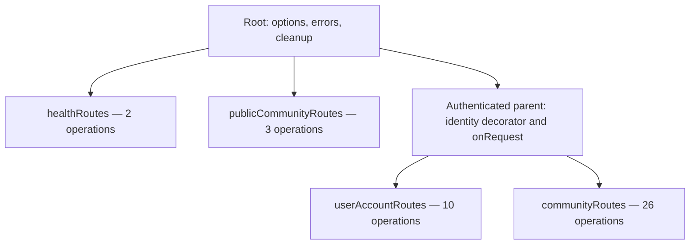
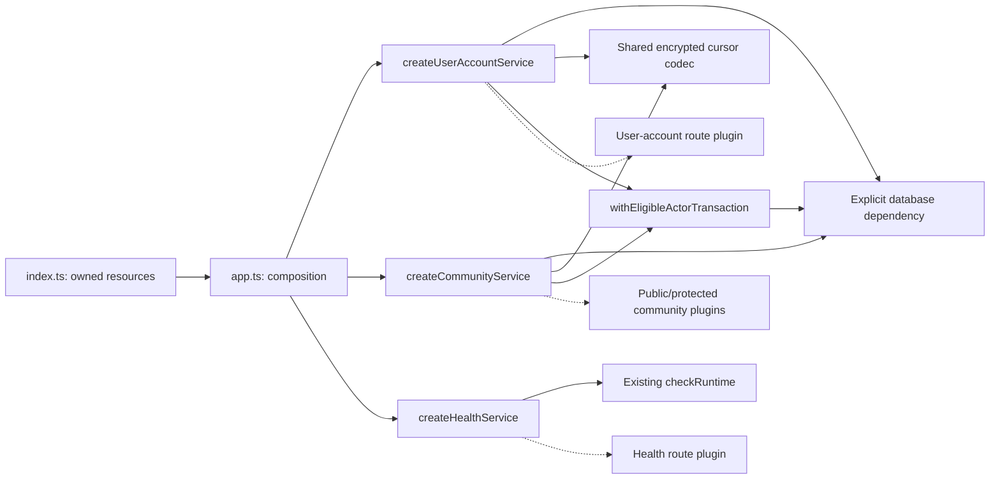

# Final Fastify architecture refactoring plan

**Status: completed and locally verified, 2026-11-04; all five phases complete.** The HTTP baseline, shared facilities/resource ownership and all three feature triads are implemented. The eight community groups retain their independent commits. Phase 5 completes health, transport typing and final cleanup/verification. See [Phase 1 evidence](evidence/fastify-phase-1-2026-11-04/README.md), [Phase 2 evidence](evidence/fastify-phase-2-2026-11-04/README.md), [Phase 3 evidence](evidence/fastify-phase-3-2026-11-04/README.md), [Phase 4 evidence](evidence/fastify-phase-4-2026-11-04/README.md) and [Phase 5 evidence](evidence/fastify-phase-5-2026-11-04/README.md).

This plan governs the structural refactor of the existing persistent API. The [approved API transition](20-persistent-api-transition-proposal.md), [intended access matrix](16-intended-access-matrix.md), and [final access audit](21-final-local-access-audit.md) remain the behavior and security context. It supersedes earlier proposed target structures from the architecture-planning discussion, not accepted product or database requirements.

## 1. Scope and target structure

Refactor the existing API into frontend-aligned features with mandatory `routes.ts`, `service.ts`, and `schema.ts` files. Preserve all 41 explicit HTTP operations, 28 automatic HEAD operations, and existing security/database behavior.

Phase 1 changed tests/documentation, Phase 2 changed shared facilities/callers, Phase 3 moved user-account operations into their triad, Phase 4 migrated all eight community groups, and Phase 5 completed health, transport typing and final reconciliation. All preserve the HTTP contract. No shared browser contract, database migration, runtime privilege or frontend change is included.

```text
server/src/
├── index.ts
├── app.ts
├── token-verifier.ts
├── http-authentication.ts
├── http-errors.ts
├── application-errors.ts
├── database.ts
├── actor-transaction.ts
├── directory-cursors.ts
│
├── user-accounts/
│   ├── routes.ts
│   ├── service.ts
│   └── schema.ts
├── communities/
│   ├── routes.ts
│   ├── service.ts
│   └── schema.ts
└── health/
    ├── routes.ts
    ├── service.ts
    └── schema.ts
```

The authentication/error filenames resolve concrete responsibility overlap without adding runtime layers.

### Authentication and error ownership

| Module | Exact responsibility |
| --- | --- |
| `token-verifier.ts` | Construct the Supabase-backed bearer verifier and validate token identity claims. No Fastify imports, hooks, HTTP responses, or database eligibility checks. |
| `http-authentication.ts` | Required/optional HTTP authentication integration, request identity decoration, authenticated-context extraction, and existing authentication-related cache headers. Receives the verifier explicitly; does not construct it. |
| `actor-transaction.ts` | Export the plain `AuthenticatedContext` type and transaction helper. Set trusted attribution and perform the existing locked database eligibility check. No Fastify dependencies. |
| `application-errors.ts` | Define `ApplicationError`, moved from `CommunityError`, retaining the existing status/code representation. No Fastify or community dependencies. |
| `http-errors.ts` | Own the common error-response schema and existing root error-handler translation/logging. Preserve PostgreSQL, application-error and unexpected-error mappings exactly. |

Authentication failures retain the current direct 401 response. They do not need to pass through a new exception mechanism.

Feature-specific result-to-HTTP mappings remain in `routes.ts`. Operation-specific failures remain explicit; the root error handler must not normalize distinct existing outcomes.

### Other root responsibilities

- `index.ts`: validate configuration, construct resources, start listening, handle signals and startup failures.
- `app.ts`: construct feature services, register plugins, install root options/errors and owned cleanup.
- `database.ts`: retain pool/Kysely construction, database types and runtime verification.
- `directory-cursors.ts`: retain the shared encrypted cursor mechanism; feature services retain their endpoint-specific scopes and other existing cursor formats.

No additional architectural directories, repository layer, DI container, validation library, or `fastify-plugin` dependency are required.

## 2. Feature ownership and parallel organization

Every feature uses identical section names and ordering across its three files. Within a section, route declarations, public service operations and schema exports follow the same operation order.

Use concise section comments. Place supporting helpers immediately after their related operations; place genuinely feature-wide helpers in a final `Internal helpers` section. Shared schema fragments may precede the operation sections.

Sections are navigation aids, not additional plugins or directories.

### `user-accounts`: 10 operations

All routes register beneath the authenticated parent.

| Section, in order | Operations | Frontend correspondence |
| --- | --- | --- |
| **Account preferences** | GET/PUT `/api/me/preferences` | `user-accounts/api.ts`; Settings |
| **Own profile** | GET/PUT `/api/me/profile` | `user-accounts/api.ts`; shared profile state and editor |
| **My communities** | GET `/api/me/communities` | `user-accounts/api.ts`; personal community list |
| **Global profiles** | GET `/api/profiles`; GET `/api/profiles/:userId` | No current frontend adapter |
| **Account blocks** | GET `/api/me/blocks`; PUT/DELETE `/api/me/blocks/:userId` | No current frontend adapter |

Personal community summaries remain owned here because this feature owns the operation and its frontend adapter. Reading community relations does not require an additional community-service layer.

`AuthShell` initializes shared account state through the existing user-account hook. This shared consumption does not create a second HTTP owner.

### `communities`: 29 operations

Here, `C` means `/api/communities/:tenantId`.

| Section, in order | Operations | Count |
| --- | --- | ---: |
| **Public access and standing** | GET `/api/community-standings`; GET `/api/public/communities/:slug`; GET `/api/public/communities/:slug/directory` | 3 |
| **Creation and lifecycle** | POST `/api/communities`; POST `C/commands` | 2 |
| **Requests and reviews** | GET `C/me/request`; GET `C/accounts/:target/review`; GET `C/staff-candidates`; GET `C/requests` | 4 |
| **Profiles and preferences** | GET `C/accounts/:userId/profile`; PATCH `C/me/profile`; GET/PATCH `C/me/preferences` | 4 |
| **Configuration and copy** | GET/PATCH `C/details`; GET/PATCH `C/settings`; GET `C/copy`; PUT/DELETE `C/copy/:contentKey` | 7 |
| **Directories and account facts** | GET `C/directory`; GET `C/accounts`; GET `C/accounts/:userId` | 3 |
| **Staff and participant permissions** | GET `C/staff`; GET `C/staff/:userId`; GET `C/participant-permissions`; GET/PATCH `C/accounts/:userId/permissions` | 5 |
| **Audit history** | GET `C/history` | 1 |

The three public operations register outside the authenticated parent. The other 26 register beneath it.

Frontend consumers remain:

- Creation: `communities/api.ts` through `command-client.ts`, connected to the creation UI.
- Commands: `sendCommunityCommand` adapter exists without a current non-test UI caller.
- Own profile/preference writes: adapters exist in `communities/api.ts`; current sample screens use mock saves.
- Remaining operations: no current frontend adapter.

No new frontend callers or frontend restructuring are included.

### `health`: 2 operations

Parallel sections are **Liveness**, then **Readiness**:

- GET `/health/live`
- GET `/health/ready`

Health has no frontend counterpart because it serves operational probes. It still follows the three-file convention.

Other frontend features currently use Supabase Auth or mock functionality; do not create empty backend features for symmetry.

## 3. Plugin boundaries, dependencies and contracts

### Fastify hierarchy



`communities/routes.ts` exports both `publicCommunityRoutes` and `communityRoutes`. No additional public/reference directory or plugin nesting is needed.

Preserve these lifecycle distinctions:

- Protected routes inherit required authentication and `private, no-store`.
- Public landing/directory retain route-specific optional authentication in `onRequest` and `no-store`.
- Standing reference retains optional verification inside its handler, after validation, with its existing cache behavior.
- Health remains outside authentication.
- Preserve complete existing paths, automatic HEAD registration and root not-found behavior.

### Service construction



Factories return ordinary named functions:

- `createUserAccountService({ db, cursors })`
- `createCommunityService({ db, cursors })`
- `createHealthService({ checkReadiness })`

Plugin options contain only their required service operations. Public community registration additionally receives the bearer verifier. Protected feature plugins do not receive database handles or verifiers.

No direct dependency between the two feature services is needed for current operations. Preserve existing private PostgreSQL functions for cross-table authority and projections.

### Final abstraction names

- **`AuthenticatedContext`**: readonly `{ actorId: string; requestId: string }`. Represents verified identity and correlation, not current eligibility or authorization.
- **`withEligibleActorTransaction(db, context, work)`**: ordinary function replacing `withVerifiedActor`; preserves its transaction and SQL sequence.
- **`EligibleActorTransactionResult<T>`**: `{ eligible: false } | { eligible: true; value: T }`, local to the transaction facility. Prevents collisions with application results containing `status`; it is not a universal service result envelope.
- **`BuildApiOptions`**: required `{ db, verify, cursors, cleanup }` application construction inputs only—database, verifier, cursor codec and explicit asynchronous cleanup callback. Never passed wholesale to features. The old positional construction signature is removed.

Normal cleanup belongs to `app.close()` after `buildApi` successfully returns. Startup cleans up allocated resources when construction fails before ownership transfers; later boot/readiness/listener failures close the returned app. Startup supplies one memoized cleanup promise and shares one close request across shutdown signals. Preserve cleanup exactly once, await failed-startup cleanup, retain the original startup failure if cleanup also rejects, and remove installed signal handlers on close. Shutdown failures use a generic diagnostic and nonzero exit status. No new timeout or force-close policy is introduced.

### Three-file dependency rules

**`routes.ts`**

- Owns Fastify registration, lifecycle integration, schema attachment, validated input/context extraction and HTTP response mapping.
- Calls named service operations.
- Contains no SQL, transaction orchestration or substantial business authorization.
- Never imports another feature's HTTP adapter.

**`service.ts`**

- Owns application operations, current-state authorization, SQL, transaction orchestration, locking and audit coordination.
- Receives resource dependencies explicitly.
- Has no Fastify imports or runtime imports from feature `schema.ts` or HTTP utility modules.
- Uses explicit database projections independent of response schemas.

**`schema.ts`**

- Owns feature HTTP schema composition and appropriate schema-derived transport types.
- Uses TypeBox. The feature plugins use Fastify's matching type provider to infer request and reply types from attached schemas. AJV and the Fastify response serializer consume the emitted JSON Schema. The [TypeBox adoption decision](08-decisions-and-open-questions.md#typebox-for-fastify-http-schemas--accepted-direction-2026-11-09) supersedes the plain JSON Schema and `json-schema-to-ts` tooling used at Phase 5 completion.
- Contains no database access, authorization queries or business execution.

### Schema and DTO boundary

Keep HTTP definitions with their owning workspace features. The TypeBox adoption checkpoint shared the account-preference field list. The [workspace ownership follow-up](#6-workspace-ownership-and-typebox-follow-up--2026-11-09) supersedes that layout.

Services may import server-owned DTO types and domain constants. They must not use runtime HTTP schemas to choose SQL columns, implement policies or interpret database state.

Specifically, replace `preferencesSchema.required` as the preference SQL projection source with an explicit database column allowlist in the service. Preserve precisely the same selected fields.

Keep application imports within each workspace. Verify agreement between workspace-local HTTP definitions at the HTTP boundary.

Schema relocation must not tighten inputs, add header validation, change error precedence, close intentionally open fields, or alter serialization. Health defines fixed success-body schemas for reply typing only; its routes preserve absent runtime schemas and unrestricted request inputs.

## 4. Incremental implementation and mandatory verification gates

### Phase 1 — Documentation and baseline

- Record the final structure, ownership map, section order and dependency rules in repository documentation.
- Capture all operation registrations, HEAD behavior, HTTP schemas, statuses, cache directives, body limits and lifecycle exceptions.
- Run the existing local integration baseline before application changes.
- Add focused injection tests for authentication scope, validation precedence, response mapping and plugin isolation.

Record existing failures separately; do not weaken assertions to establish a passing baseline.

Phase 1 is complete at checkpoint `a5cb9d1`: all 14 injection cases, server TypeScript and root lint passed; the original nine real Auth/HTTP suites and client boundary scan passed both before and after additions. The checked-in [HTTP contract fixture](../server/tests/fixtures/http-contract.json) captures all 69 registrations, full schemas (shared by GET/HEAD), declared response statuses, effective body limits and authentication categories. `npm run test:http -w server` runs the environment-independent HTTP gate. [Baseline evidence](evidence/fastify-phase-1-2026-11-04/README.md) records actual handler/error mappings, cache and cursor contracts, lifecycle exceptions, integration coverage and test results. Do not refresh the fixture merely to pass a structural refactor; investigate any drift against the preserved contract. Permanent architecture guidance is now in `AGENTS.md`; its source-layout requirements apply as each later phase migrates its responsibilities. No Phase 1 gate remains blocked.

### Phase 2 — Shared facilities and ownership

- Establish the descriptive authentication/error modules.
- Move the error class and encrypted cursor codec without changing behavior.
- Introduce the plain context and tagged transaction result.
- Centralize construction and explicit cleanup ownership.
- Update internal imports directly; add no compatibility aliases.

Verify typechecking, error mappings, eligibility handling, construction/startup failures and cleanup. Run affected real-runtime eligibility tests before proceeding.

Phase 2 is complete and locally verified. The designated root modules now own token verification, HTTP identity/cache integration, application errors, root HTTP error translation, encrypted cursors and actor transactions. Protected requests receive fresh `authenticatedContext` objects; all callers distinguish the `eligible` tag from their inner operation result. Existing feature registrations and SQL remain in place. `buildApi` takes `BuildApiOptions`; the import-safe `startApi`/`readApiConfig` functions in `index.ts` own resource construction and startup failure handling. Narrow constructor/check dependencies permit lifecycle verification without a DI container. All superseded imports/modules and positional construction calls are removed, including in the unexecuted hosted verification script.

The unchanged Phase 1 fixture, all 36 HTTP/shared-facility/startup cases, server TypeScript, root lint, all nine real Auth/HTTP suites and the 130-file client boundary scan passed. The source comparison retained all 110 SQL templates; frontend/shared contracts, migrations, dependency lockfile and runtime privilege manifest remain unchanged. [Phase 2 evidence](evidence/fastify-phase-2-2026-11-04/README.md) records lifecycle cases, cursor-vector preservation, API changes, local ports and remaining verification boundaries. No Phase 2 gate remained blocked at checkpoint `0c2266d`; preference SQL projection cleanup and feature service construction were deferred to their feature phases.

### Phase 3 — User-account feature

Move operations into the standard triad in its prescribed section order. Register the resulting feature beneath the authenticated parent.

Verify preferences, self-service and global-profile integration suites, relevant frontend tests, and isolated HTTP adapter tests.

Phase 3 is complete and locally verified from checkpoint `0c2266d`. `user-accounts/routes.ts`, `service.ts` and `schema.ts` own the ten operations in the prescribed five-section order. `createUserAccountService({db,cursors})` returns named operations; `UserAccountService` types the service-only `userAccountRoutes` plugin. Application composition constructs one service and registers the encapsulated plugin beneath the authenticated parent, without a prefix or additional authentication hook. Routes own transport/schema attachment and preserve preference eligibility/status mapping; services own SQL and transaction orchestration without runtime HTTP imports. The preference SELECT/RETURNING projection now has its explicit three-column allowlist, independent of the shared HTTP schema.

`ownProfile`, `inspectGlobalProfile` and `setOwnBlock` remain exported transaction-taking implementations in the service so existing real rollback/snapshot tests retain control of their transaction. No compatibility alias or parallel HTTP interface is retained. Superseded preference/global-profile modules and inline account routes are removed. At the Phase 3 checkpoint, three community self-service operations remained in `accounts/self-service.ts`, registered as `registerCommunitySelfService`, until Phase 4 checkpoint 4; their SQL, helpers and authorization were unchanged. Personal community summaries remain owned by user accounts without a community-service dependency.

The unchanged Phase 1 fixture, all 43 backend HTTP/shared/startup/adapter cases, server TypeScript, root lint, all nine local real Auth/HTTP suites, the 130-file client boundary scan and 74 relevant frontend tests in 11 files passed. All 110 SQL template expressions and eight moved/retained query-helper bodies match the prior checkpoint; cursor formats, frontend/shared contracts, migrations, dependency lockfile and runtime privilege manifest remain unchanged. [Phase 3 evidence](evidence/fastify-phase-3-2026-11-04/README.md) records interfaces, scope boundaries, environment and verification. No Phase 3 gate remained blocked at checkpoint `aeb1ff6`; the following section records Phase 4 execution.

### Phase 4 — Community feature, one operation group at a time

**Phase 4 checkpoint 8/8 — verified 2026-11-04.** 29 of 29 community operations now belong to the triad, through audit history. One centrally constructed service supplies explicit public/protected operation subsets; only the public plugin receives the verifier. All 54 backend cases, server TypeScript, root lint and this checkpoint's required local suites passed. The HTTP fixture and database/security contracts remain unchanged. All superseded community modules are removed; health restructuring and Phase 5 final verification remain deferred. See [Phase 4 evidence](evidence/fastify-phase-4-2026-11-04/README.md).

Phase 4 completed from `aeb1ff6` through eight ordered, independently committed checkpoints. The final community triad owns three public and 26 protected operations, plus 20 automatic HEADs; application totals remain 41 explicit operations and 28 HEADs. One `createCommunityService({db,cursors})` supplies explicit public/protected operation subsets. Only `publicCommunityRoutes` receives the verifier; `communityRoutes` inherits the existing protected parent. All legacy community registrations and modules, including the temporary account self-service module, are removed. The service preserves real transaction-taking implementations without compatibility interfaces, HTTP/schema runtime imports or schema-driven SQL projections. All 110 SQL templates and 35 moved query/authorization helper bodies match after documented binding/name/format normalization. All 54 backend cases, server TypeScript, root lint, all nine local real Auth/HTTP suites and the 130-file client boundary scan passed. Relevant frontend verification passed 64 tests in nine files. No required Phase 4 gate remains blocked. See [Phase 4 evidence](evidence/fastify-phase-4-2026-11-04/README.md).

**Do not consolidate all 29 operations in one rewrite.**

Use the section order as the migration order. For each group:

1. Move its existing schemas, operations and routes into the corresponding sections of the new triad.
2. Preserve SQL text, statement order, transaction boundaries and existing outcome mappings.
3. Switch registration exactly once; remove the superseded registration.
4. Update affected test imports while retaining their transaction control and assertions.
5. Run focused HTTP tests and the existing relevant integration, authorization and concurrency suites.
6. Review the diff and checkpoint the verified group before starting the next.

| Migration group | Required existing verification |
| --- | --- |
| Public access and standing | Configuration and directory suites; public identity/cache behavior and visibility/change serialization |
| Creation and lifecycle | Community suite; self-service sharing/lifecycle interactions; stale requests, authority/archive races and rollback |
| Requests and reviews | Community and access-audit suites; queue authority, own-request projection, revision/request identity and exact response fields |
| Profiles and preferences | Self-service and community suites; relevant directory/global-profile cases; archived access and sharing/inactivity concurrency |
| Configuration and copy | Configuration suite; directory visibility interactions; authority changes, no-op writes and audit |
| Directories and account facts | Directory suite; pagination, projection, archive and both relevant read/change serialization orders |
| Staff and participant permissions | Records and community suites; authority boundaries, audit categories and concurrent changes |
| Audit history | History suite; category/reason isolation, pagination, archive/revocation serialization |

Run existing fixture suites sequentially. A failed or unavailable required check blocks progression to the next group until resolved or explicitly reported for a decision.

Temporary coexistence of migrated and unmigrated source modules is permitted during these checkpoints. It must not create duplicate HTTP routes, fallback interfaces or compatibility wrappers. Delete superseded files as their remaining responsibilities migrate.

### Phase 5 — Health and final reconciliation

- Complete the health triad.
- Finish transport typing and matching section organization.
- Remove remaining superseded modules and update internal/test imports.
- Reconcile architecture, file-structure, implementation-status and agent guidance.

Run the full local API suite, existing runtime-role/SQL/concurrency checks, frontend tests, build and lint. Verify that migrations and the runtime privilege manifest are unchanged.

Phase 5 is complete from checkpoint `2a08e76`. The health triad uses matching Liveness/Readiness sections. `createHealthService({checkReadiness})` returns ordinary `readLiveness`/`readReadiness` operations; `healthRoutes` receives only their service and registers outside authentication. Composition supplies the existing `checkRuntime(db)` callback once; root startup/cleanup ownership and SQL remain unchanged. Health's schema file derives reply types without attaching runtime schemas, preserving the Phase 1 absence and accepting existing request inputs.

Community routes now use schema-owned params/query/body types with literal-preserving schema composition. Shared discriminated commands and preference/settings DTOs remain explicit exceptions for dynamically assembled maps. The old Data API regression script now imports real service implementations and uses verified context plus explicit eligibility/result unwrapping; no compatibility interface remains. All triads and dependency/section boundaries are reconciled.

All 60 backend cases, server TypeScript, root lint, nine local real Auth/HTTP suites, the 130-file client boundary scan, 265 pgTAP assertions, 51 retired Data API checks, replay/populated upgrade, SQL lint, all 279 frontend tests and the production build passed. All 110 SQL templates, existing account/community services, shared facilities and nine real integration suites are unchanged. The HTTP fixture, 41 explicit operations/28 HEADs, cursor formats, migrations, client/shared contracts, dependency lockfile and runtime privilege manifest are unchanged. No required gate remains blocked. [Phase 5 evidence](evidence/fastify-phase-5-2026-11-04/README.md) records commands, environment, the resolved lint issue and existing nonblocking notices. No hosted execution or deployment is included.

Each phase and community group must be independently reviewable and reversible through its code commit. No database migration or deployment rollback is required.

### Review follow-ups — port validation and AJV defaults

Completed from checkpoint `2448c1e` on 2026-11-04. Environment `PORT` now requires ASCII decimal digits representing an integer from `0` through `65535`; absent values retain the `3001` default and leading zeros/explicit `0` are accepted. Empty/whitespace, signed, fractional, hexadecimal, exponent and out-of-range forms are rejected. Numeric programmatic ports are validated at the start of `startApi`, before verifier/cursor construction and database allocation. Failures use `Error("PORT must be a decimal integer between 0 and 65535.")`; the CLI retains its existing generic diagnostic and nonzero status.

A fresh test harness registers a test-only route with an optional default-bearing query field, proving that `useDefaults:false` preserves absent input and explicit values. It neither changes production routes nor enters the fixture-comparison application. All 63 backend cases, server TypeScript and root lint passed sequentially. The HTTP fixture and prior Phase 1–5 evidence remain unchanged. See [follow-up evidence](evidence/fastify-review-followups-2026-11-04/README.md). No Supabase execution, database changes, environment-file edits, dependency changes or frontend work are included; the completed five-phase architecture remains intact.

## 5. Acceptance criteria and permanent guidance

All existing behavior remains unchanged:

- HTTP methods, URLs, statuses, response shapes and automatic HEAD routes.
- Validation, error precedence, body limits, cache headers and cursor formats.
- Authentication, eligibility, standing, permission and source-validation outcomes.
- Transaction boundaries, snapshots, isolation assumptions and lock ordering.
- Trusted attribution, audit behavior, idempotency, no-op behavior and concurrency guarantees.
- RLS, grants, constraints, triggers and private database functions.

Preserve notable exceptions explicitly: standing-reference authentication timing, review's `unavailable` outcomes, empty unauthorized history pages, null-versus-missing results, archived-owner access, and exact inactive-profile access versus enumeration.

Real-runtime authorization, bypass, rollback and concurrency tests remain authoritative. Injection tests establish HTTP wiring and plugin boundaries, not database correctness.

### Repository-level architecture contract

The following durable rules are recorded in the existing agent guidance by Phase 1 and apply as the corresponding source responsibilities migrate:

- Match backend HTTP feature names to frontend feature ownership by default. Assign each operation one authoritative owner and document functional exceptions.
- Every HTTP feature has `routes.ts`, `service.ts`, and `schema.ts`, regardless of size.
- Maintain identical operation section names and ordering across the three files.
- Routes own HTTP integration; services own operations and database orchestration; schemas own transport validation and serialization.
- Keep runtime HTTP schemas out of service logic and SQL projections. Keep HTTP definitions workspace-local and preserve the distinction between transport, domain and database types.
- Register encapsulated feature plugins. Put shared authentication in the authenticated parent and feature hooks in their proper scope.
- Keep public/protected registrations in the same feature directory when they share ownership. Do not add nesting merely to mirror files.
- Construct resources and service instances centrally and pass narrow explicit dependencies. Do not introduce a global service locator.
- Keep token verification, HTTP authentication, transaction eligibility and error translation under their designated owners.
- Use request decorators for verified context; permit infrastructure decorators only for a concrete lifecycle or encapsulation benefit.
- Prefer cohesive feature files. Additional supporting modules require a demonstrated responsibility, not a file-length threshold.
- Preserve PostgreSQL authority and existing security/consistency behavior.
- Migrate community operation groups incrementally and pass their existing integration, authorization and concurrency checks before continuing.
- Update documentation when ownership or boundaries change. Do not reorganize the frontend for symmetry.

## 6. Workspace ownership and TypeBox follow-up — 2026-11-09

The [accepted design](08-decisions-and-open-questions.md#fastify-schema-follow-up--accepted-design-2026-11-09) defines the pre-MVP target. [Issue #3](https://github.com/JonDManningDev/the-crowded-table-app/issues/3) tracks the two implementation checkpoints.

1. **Workspace ownership.** Move every HTTP definition out of `shared/` into the owning features in `client/` and `server/`. Split the files used by both applications, and move the generated database types to the server. Use the browser SDK for Auth and update the type-generation command and affected source and test imports. Preserve the exact HTTP fixture. Verify the browser Auth flows, the HTTP adapters, workspace import ownership and the browser data-access boundary.
2. **TypeBox simplification.** Remove syntax-only wrappers and express tagged request variants, nullable scalars and open audit details with native builders as agreed. Preserve null and successful field stripping for nullable object replies. Keep the narrow, commented exception if a direct native form cannot do both. Check positive and nearest-denial payloads for community commands and account blocks. Check serialization for null, projected extra fields, open audit details and valid database values. Review and apply only the agreed fixture differences after those behavior checks pass.

Run server TypeScript, the HTTP suite, the local real Auth/HTTP suites and the client boundary scan, frontend tests, lint and the production build at each checkpoint. Review each diff and commit it independently once the required checks pass. Preserve the triads and existing runtime boundaries. Reconcile the current architecture, workspace guidance, runbooks and implementation status with the verified result.

The [workspace ownership checkpoint](12-implementation-status.md#workspace-http-ownership-checkpoint--2026-11-09) passed all gates locally, including the unchanged HTTP fixture. TypeBox simplification remains the next checkpoint.
